# SiteKit Admin Guide

Updated 2026-10-15 · Online version: https://claude.ai/code/artifact/280d3335-e5b2-47cd-8333-4c982bf5f4a0

## Before you start

SiteKit connects this Joomla site to Google Search Console, Analytics 4, Tag Manager and Site Verification, and shows their reports inside the administrator. You find it under **Components → SiteKit**, which has four screens: **Dashboard**, **Reports**, **Services** and **Settings**.

**Who can do what** (set in SiteKit **Options → Permissions**):

| Permission | Lets the user |
| --- | --- |
| Access Administration Interface (`core.manage`) or **View Dashboard** | Open Dashboard, Reports and Services, and load reports |
| **Connect Google** | Connect or disconnect Google, start or end the trial, authorize scopes, save feature settings, run site verification |
| Configure ACL & Options (`core.admin`) | Everything above, plus open **Settings** and save the Google Cloud Client ID and Secret |

**Connection modes.** Every screen adapts to how Google is connected:

- **Not connected**: nothing is linked yet.
- **Trial**: you sign in with your own Google account through SiteKit's shared app. Only Search Console and Analytics reports work, with a limited number of report views and an end date.
- **Trial ended**: reports are locked until you connect your own Google Cloud client.
- **Connected (own client)**: the production setup, using a Google Cloud OAuth client you create. All features work.

The screenshots in this guide come from a test site at `http://localhost:3000`. On your site you will see your own web address instead, including in the redirect URI on the Settings screen.

## Open SiteKit and read the Dashboard

The Dashboard is SiteKit's start page. It tells you what is set up, what is still missing, and which Google services are ready. Steps 1 to 4 show a site where nothing is connected yet; step 5 shows the Dashboard once Search Console is set up.

1. In the left menu, click **Components → SiteKit → Dashboard**.

   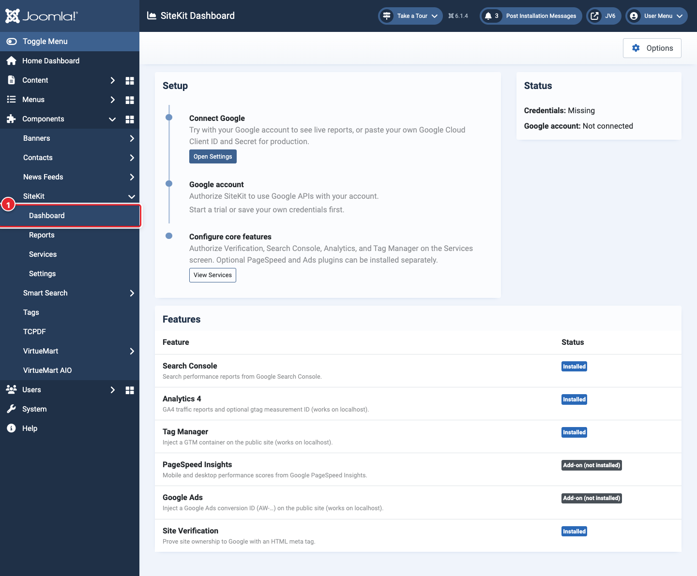

2. Follow the **Setup** box from top to bottom. It has three steps: **Connect Google** (choose the trial or your own Google Cloud client), **Google account** (sign in to Google), and **Configure core features** (choose which Google services to use). A step that is done shows a green **Ready** or **Connected** label. Each step has a button that takes you to the right screen.

   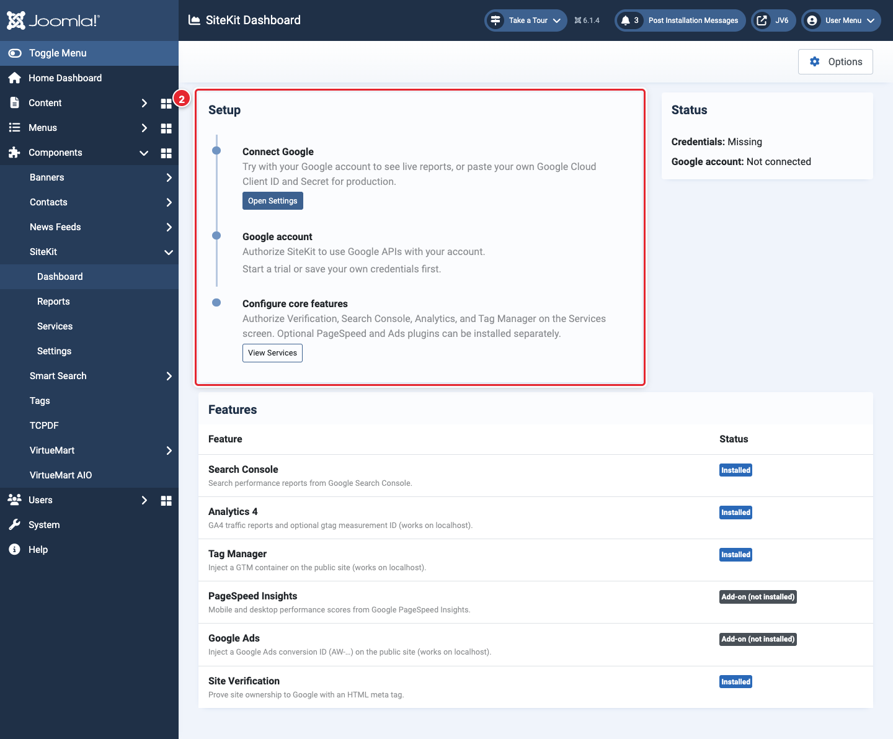

3. Check the **Status** box for a quick summary. **Credentials** shows whether your Google Cloud details are saved (**Ready** or **Missing**). **Google account** shows whether SiteKit is signed in to Google (**Connected** or **Not connected**).

   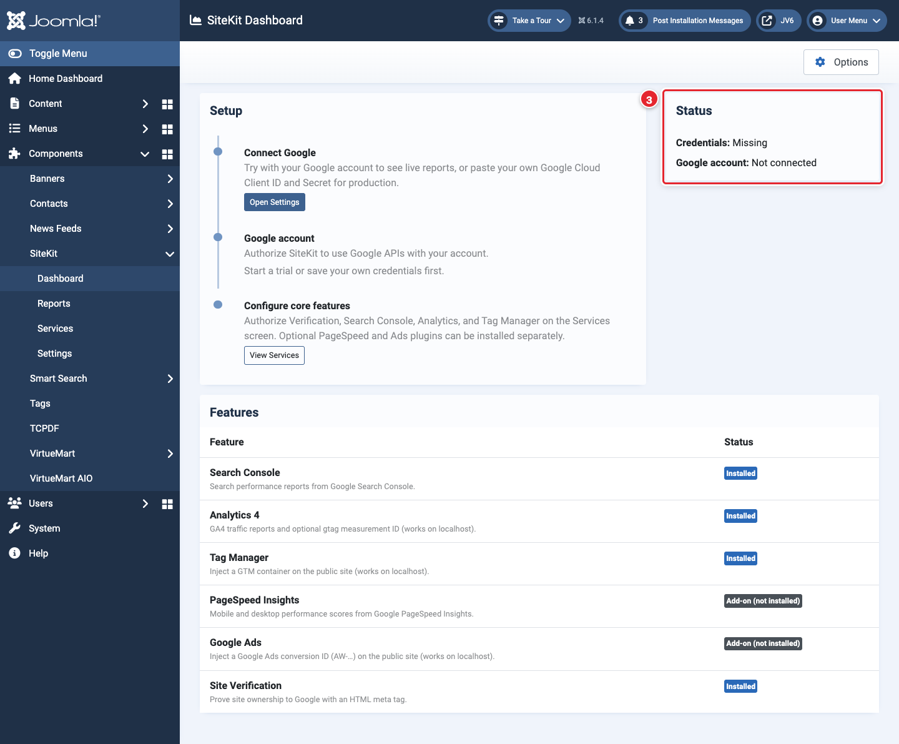

4. Look at the **Features** list to see each Google service and its state:
   - **Connected**: set up and working.
   - **Installed**: ready to set up on the **Services** screen.
   - **Add-on (not installed)**: an optional extra that has to be installed first.

   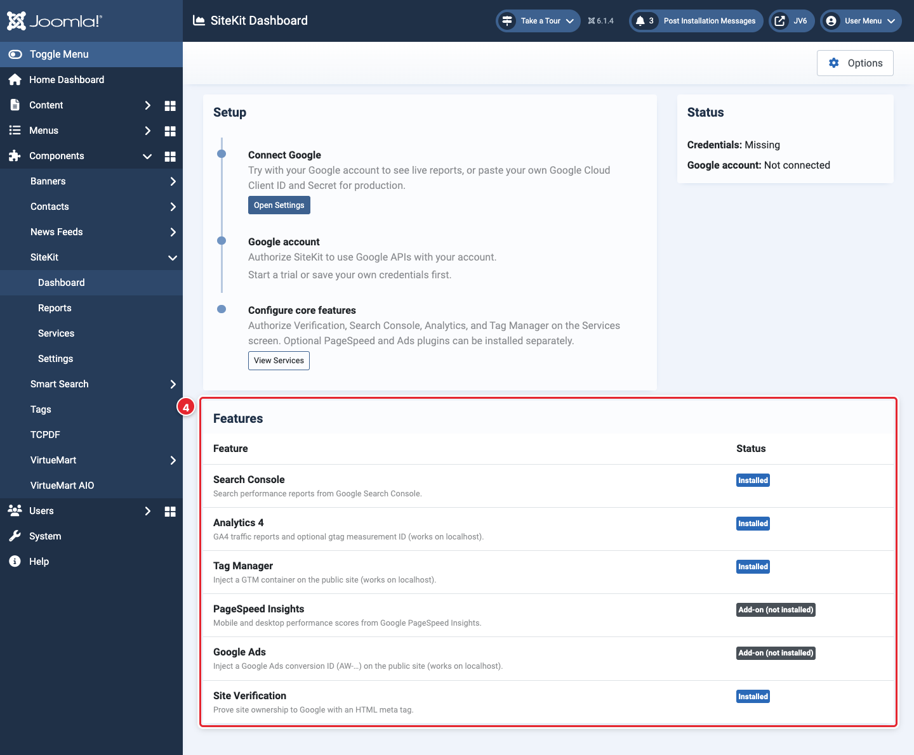

5. Once Search Console is set up, a **Search traffic** box appears at the top. It shows your clicks, impressions, average CTR and average position for the last 28 days, a daily chart (dotted lines are the 28 days before), and your top five Google searches. Click **View Search Console report** for the full report.

   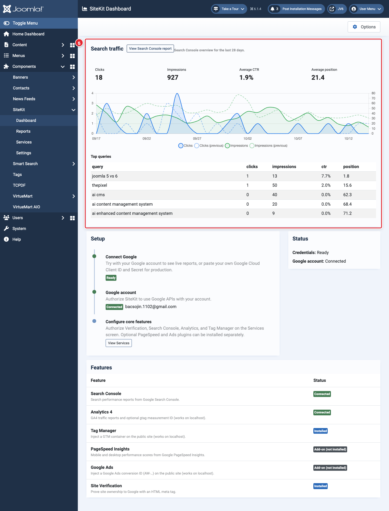

The Dashboard updates by itself as you finish each setup step, so it is a good place to check what is still missing.

## Connect Google: try SiteKit with your Google account

The trial lets you see your real Search Console and Analytics reports without setting anything up in Google Cloud. It is limited: it covers Search Console and Analytics reports only, allows a set number of report views, and ends on a fixed date. For ongoing use, connect your own Google Cloud client (next section).

1. Go to **Components → SiteKit → Settings** and click **Try with my Google**.

   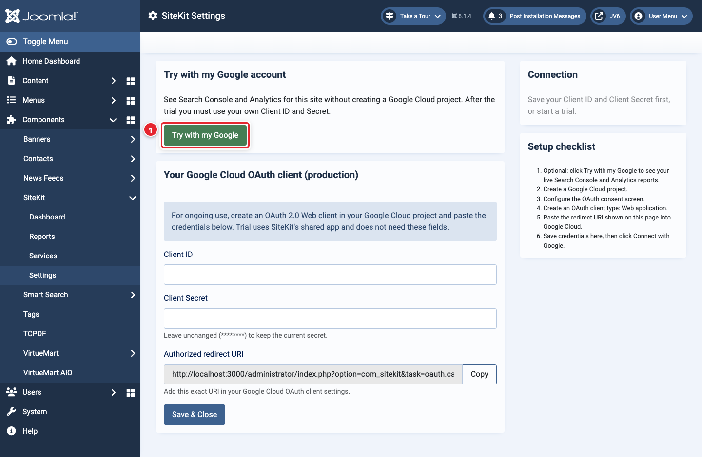

2. On Google's page, choose the Google account that manages your site in Search Console and Analytics, then allow access. Google sends you back to SiteKit.
3. A blue **Demo trial** banner now shows on every SiteKit screen. The Settings screen shows how many report views are left and when the trial ends.

To stop the trial, click **End trial** on the Settings screen. If you get the message **Trial service request failed**, the trial service is not available: connect your own Google Cloud client instead.

## Connect Google with your own Google Cloud client

Use this for production. You need a Super User account and a Google Cloud project with an OAuth client of type **Web application**.

1. Go to **Components → SiteKit → Settings**. Click **Copy** next to **Authorized redirect URI** and add that exact URI to your OAuth client in Google Cloud Console.

   

2. Paste the **Client ID** (2a) and **Client Secret** (2b) from Google Cloud, then click **Save & Close** (2c).

   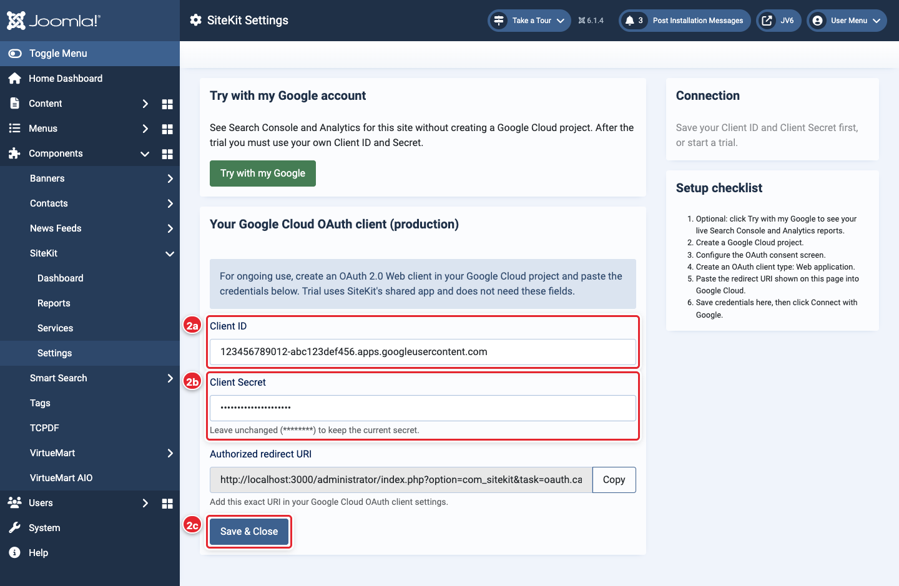

3. Open **Settings** again. In the **Connection** box, click **Connect with Google**.
4. On Google's page, choose the Google account that manages your site in Search Console and Analytics, and allow access. Google sends you back to SiteKit.
5. Check the **Connection** box: it now shows **Connected** and the Google account you used. The Dashboard shows **Ready** and **Connected** too.

   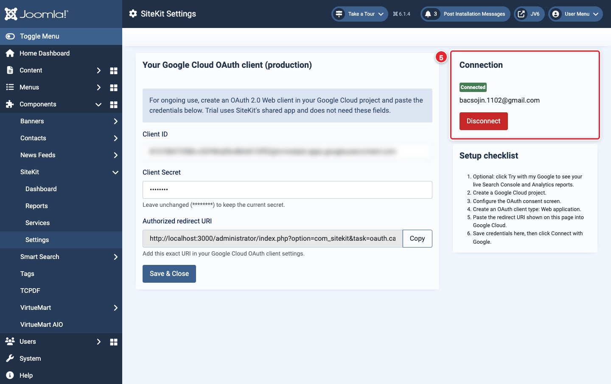

To stop using Google, click **Disconnect** in the **Connection** box. Reports stop working until you connect again. Your Client ID and Secret stay saved.

## Set up Search Console

Search Console shows how people find your site on Google: which searches show it, how often, and how often people click. Before you start, Google must be connected, and your Google account must have access to your site in Search Console. If the card shows **Authorize Google scopes** instead of a property list, click it first and allow access on Google's page.

1. Go to **Components → SiteKit → Services** and find the **Search Console** card.

   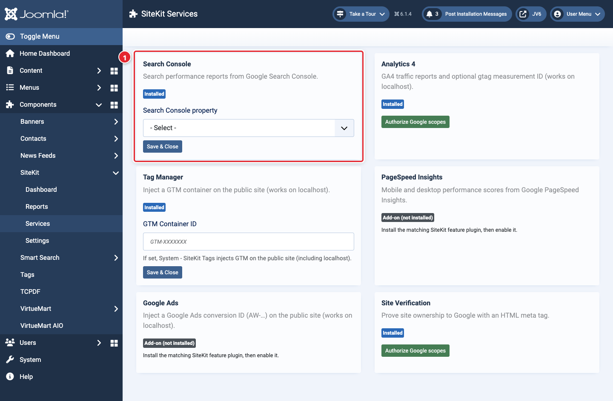

2. In **Search Console property**, choose your site (2a). If one entry matches this site, it is marked **suggested for this site**. Whole-domain properties appear as **Domain: example.com**. Click **Save & Close** (2b).

   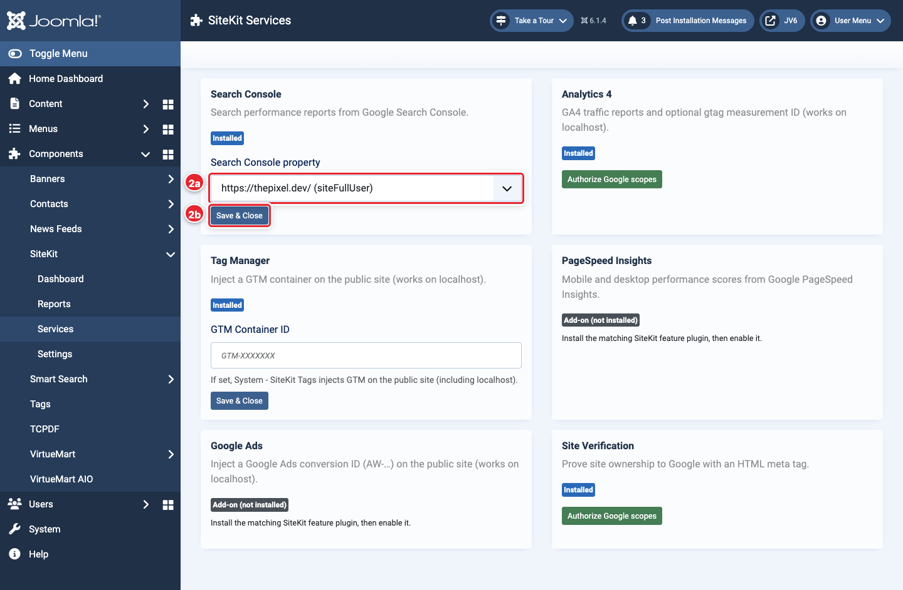

3. The card's label changes to **Connected** and shows the property you chose. A **Search traffic** box now appears at the top of the Dashboard, and the full report is available on the **Reports** screen.

   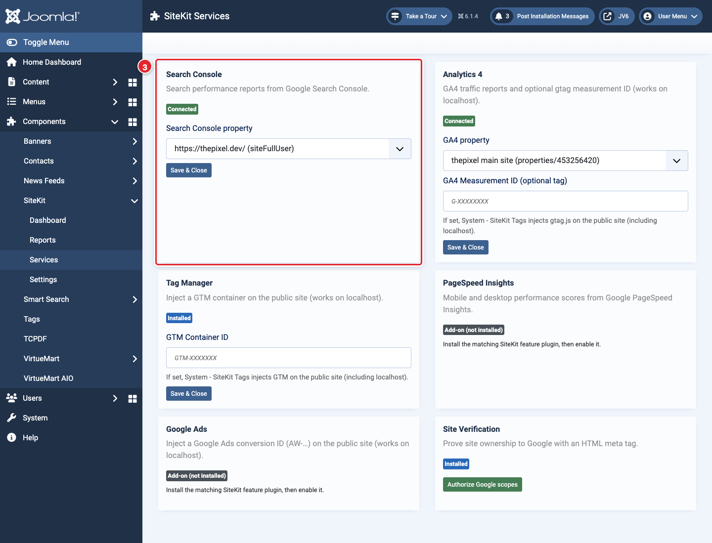

## Set up Analytics 4

Google Analytics 4 shows who visits your site: how many people, from where, on which devices and which pages. Before you start, Google must be connected, and your Google account must have access to the site's GA4 property.

1. Go to **Components → SiteKit → Services**. In the **Analytics 4** card, click **Authorize Google scopes**.

   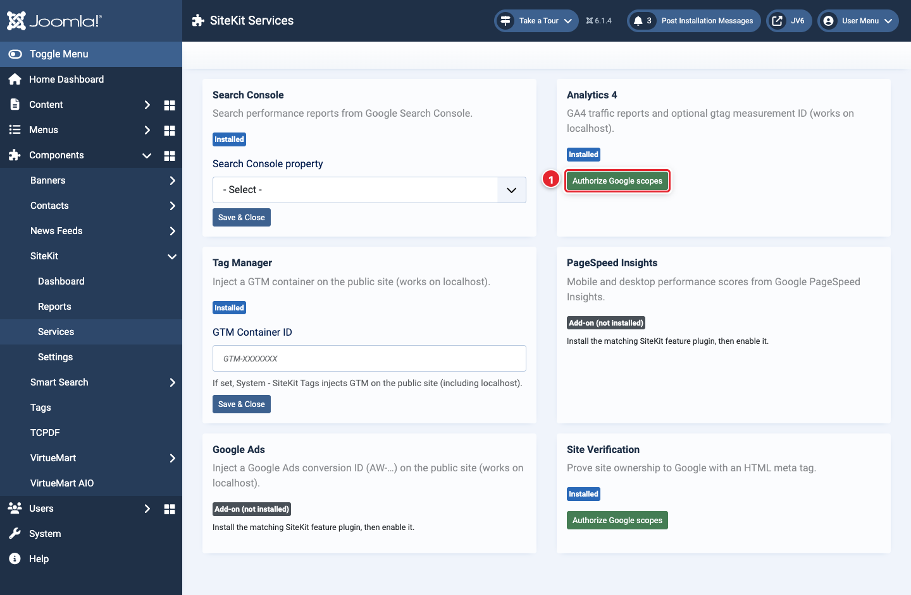

2. On Google's page, choose the same Google account and allow SiteKit to see your Analytics data. Google sends you back to the Services screen.
3. Choose your site's property in **GA4 property** (3a). Optional: in **GA4 Measurement ID (optional tag)** (3b), enter your site's ID, which starts with **G-**; SiteKit then adds the Google Analytics tracking code to every page of your public site. Leave it empty if your site already has that code, for example through your template or Tag Manager, so visits are not counted twice. Click **Save & Close** (3c).

   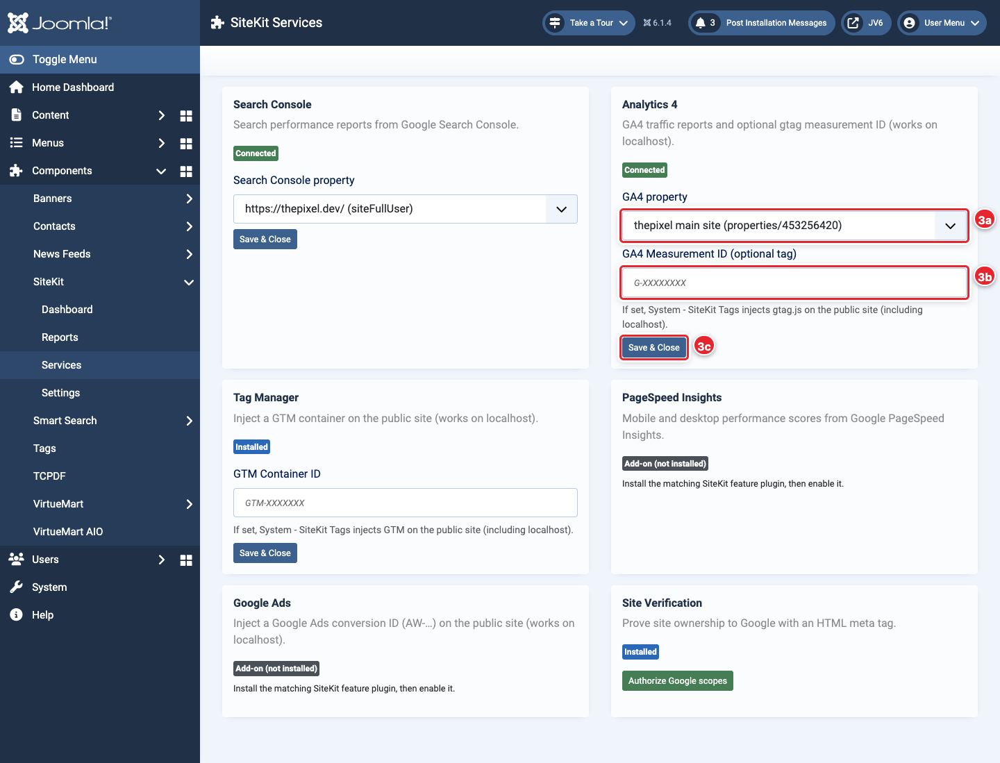

4. The card's label changes to **Connected**, and the **Analytics 4** report is available on the **Reports** screen.

   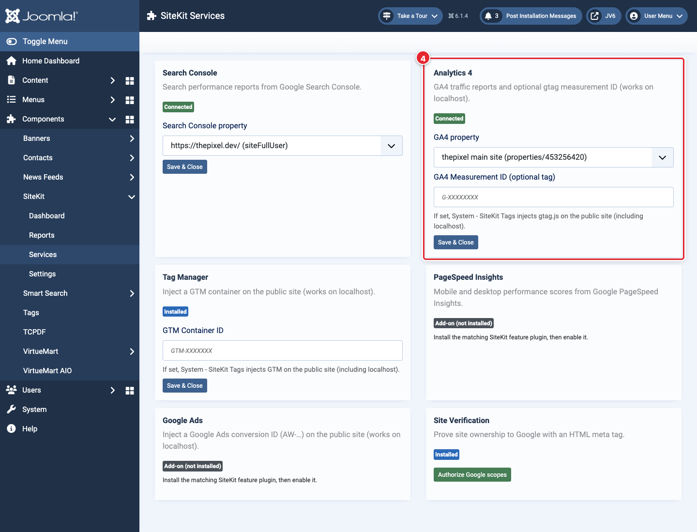

You can find the Measurement ID in Google Analytics under **Admin → Data streams**, then select your website's stream.

## Set up Tag Manager

Google Tag Manager lets you manage tracking codes (Analytics, ads, chat tools) in one place at Google, without editing your site. SiteKit only needs your container ID; no Google approval step is needed. The Tag Manager form appears once Google is connected. Your container ID is shown at the top of your workspace in Tag Manager and starts with **GTM-**.

1. Go to **Components → SiteKit → Services**. In the **Tag Manager** card, enter your ID in **GTM Container ID** (1a), then click **Save & Close** (1b).

   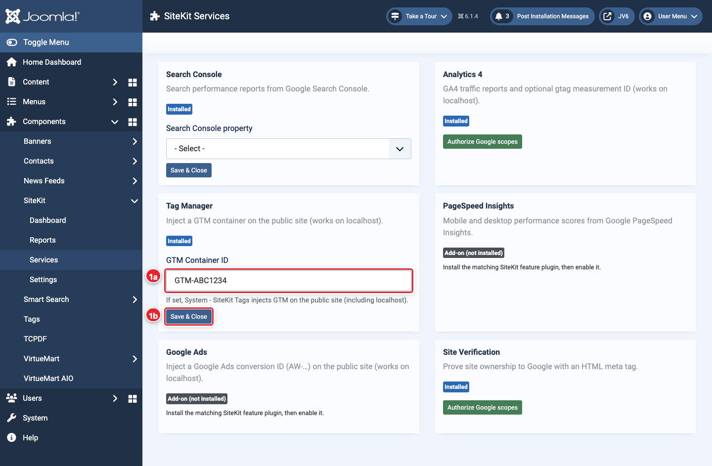

2. The card's label changes to **Connected**. SiteKit now adds the Tag Manager code to every page of your public site.

To remove Tag Manager from your site, clear the **GTM Container ID** field and click **Save & Close**. If Tag Manager already loads Google Analytics, leave the GA4 Measurement ID empty so visits are not counted twice.

## Verify site ownership

Verification proves to Google that you own the site, which Search Console needs before it shows data for a new site. SiteKit adds Google's verification tag to your pages for you. Your site must be live on the internet: Google has to visit it, so a local test site (such as localhost) cannot be verified.

1. Go to **Components → SiteKit → Services**. In the **Site Verification** card, click **Authorize Google scopes**.

   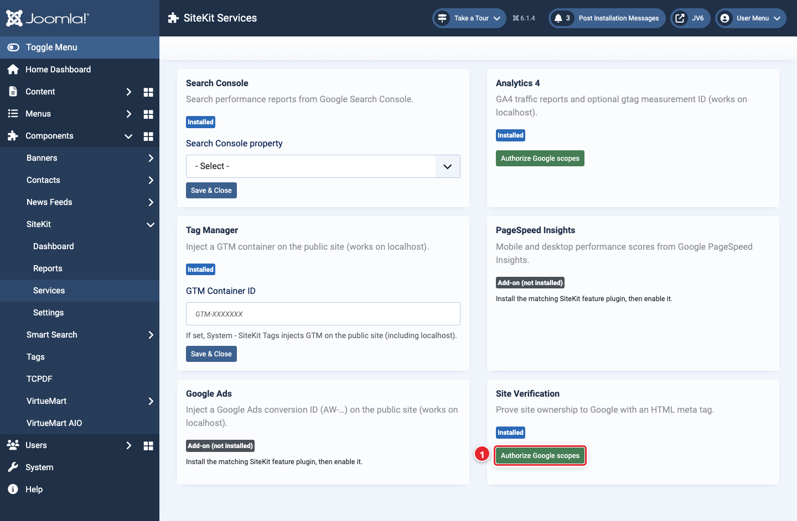

2. On Google's page, choose the same Google account and allow access. Google sends you back to the Services screen.
3. In **Site URL to verify**, enter your site's public home page address, for example `https://www.example.com/`, and click **Save & Close**.
4. Click **Get META token**. The **Verification status** changes to **Meta tag ready — publish the site, then verify**, and SiteKit starts adding the tag to your public pages.
5. Click **Verify with Google**. When Google finds the tag, the status changes to **Verified** and the card shows **Connected**.

Keep the **System - SiteKit Tags** plugin enabled after verifying: Google checks the tag again from time to time.

## Read your reports

The Reports screen shows your Google data inside Joomla. A report is available once its service is set up: Search Console needs a property, Analytics 4 needs a GA4 property.

1. Go to **Components → SiteKit → Reports** and choose a report in the **Report** list.

   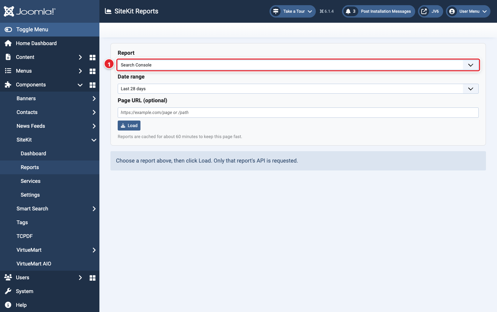

2. For Search Console and Analytics 4, choose a **Date range** (2a): the last 7, 14, 28 or 90 days. To see one page only, enter its address in **Page URL (optional)** (2b), for example `/contact`. Click **Load** (2c).

   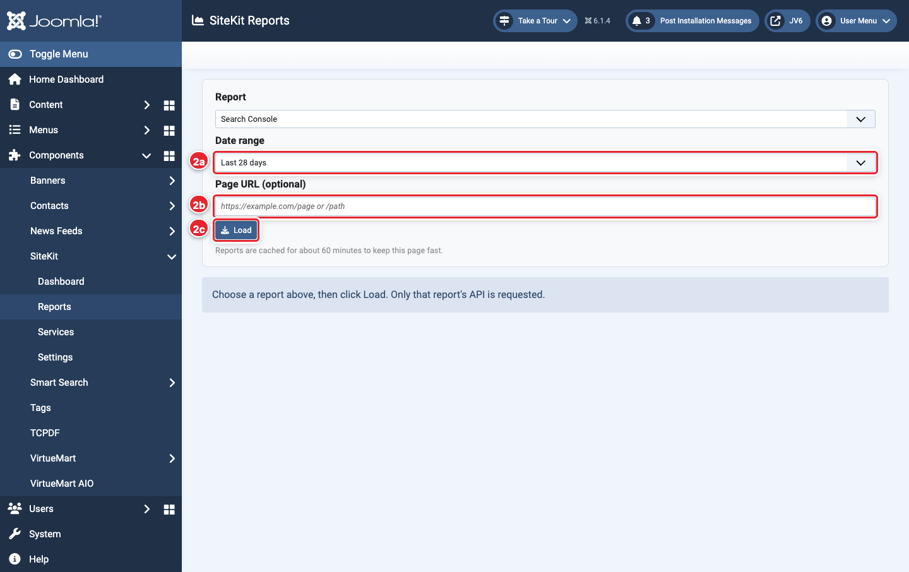

3. Read the **Search Console** report. The cards at the top (3a) show your totals; the small green or red figure under each one is the change from the period just before. The **Clicks and impressions** chart (3b) shows each day; solid lines are the chosen period, dotted lines the period before. **Top queries** and **Top pages** (3c) list the searches and pages that brought the most clicks.

   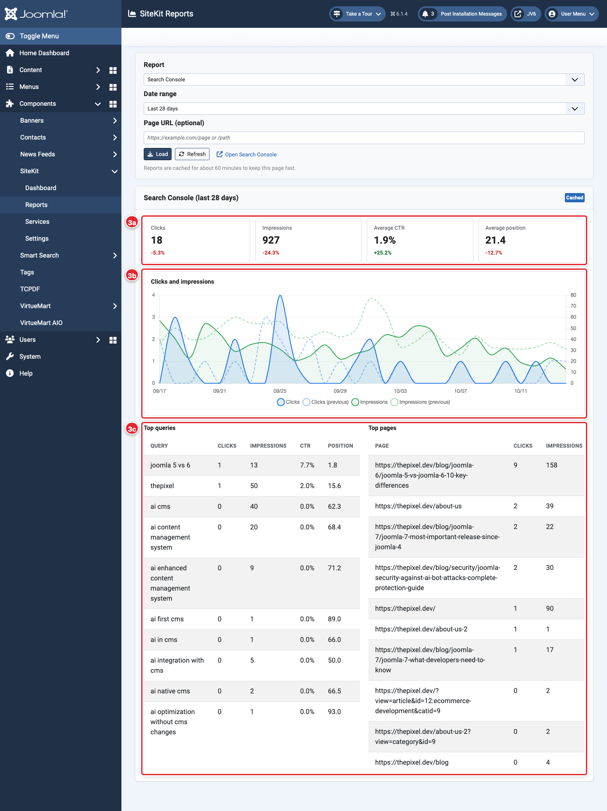

4. Reports are kept for about 60 minutes so the screen loads quickly. The label at the top right (4a) shows **Cached** (saved copy) or **Live** (just fetched from Google). Click **Refresh** (4b) to get the latest numbers. **Open Search Console** (4c) takes you to Google's own, more detailed screens.

   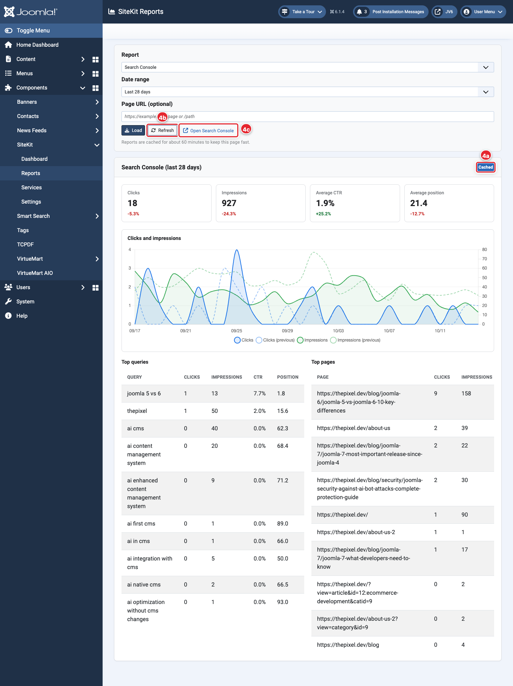

5. Choose **Analytics 4** in the **Report** list and click **Load** to read the visitor report. The cards (5a) show your totals with the change from the period before. **Users and sessions** (5b) is a daily chart. **Traffic channels** (5c) shows where visits come from, such as direct visits, Google searches or other sites. **Devices** (5d) compares desktop and mobile. The tables (5e) give the exact numbers per channel, device, country and page.

   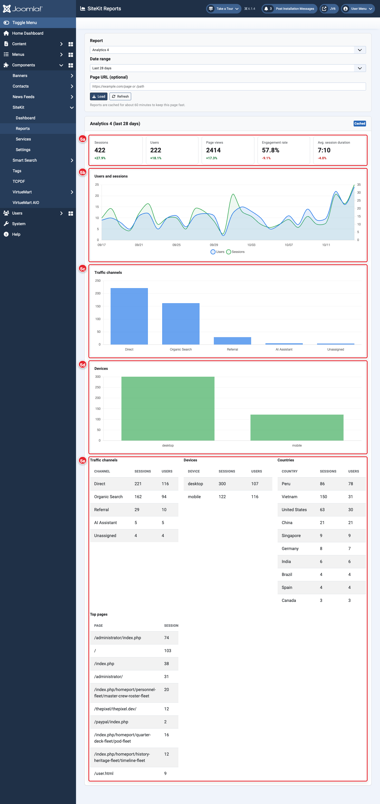

| Report | Totals | Charts and tables |
| --- | --- | --- |
| Search Console | Clicks, Impressions, Average CTR (share of people who clicked), Average position in Google results | Clicks and impressions chart, Top queries, Top pages |
| Analytics 4 | Sessions, Users, Page views, Engagement rate, Avg. session duration | Users and sessions chart, Traffic channels chart, Devices chart; tables for Traffic channels, Devices, Countries, Top pages |

**Gathering data…** means Google has no numbers yet, which is normal for up to 48 hours after you connect a property.

## Plugins, your public site and permissions

SiteKit is made of the SiteKit screens plus five plugins. Keep all five enabled.

1. Go to **System → Plugins** and type **sitekit** in the search box (1a). The list shows the five SiteKit plugins (1b); a green tick means the plugin is enabled.

   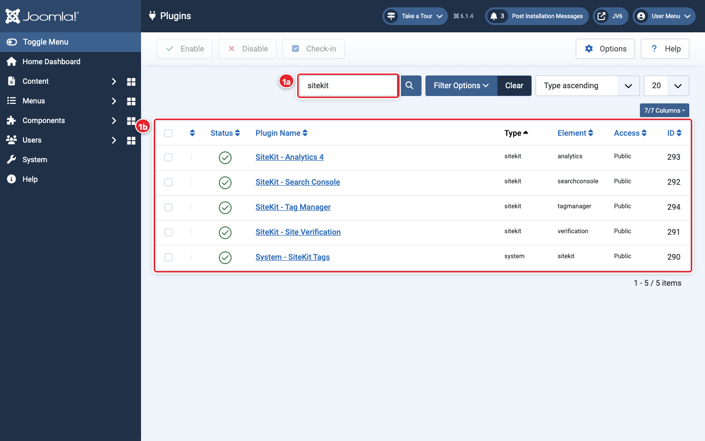

| Plugin | What it does | If you disable it |
| --- | --- | --- |
| SiteKit - Search Console | Search Console card and report | Search Console disappears from Services and Reports |
| SiteKit - Analytics 4 | Analytics card, report and tracking code | Analytics disappears from Services and Reports |
| SiteKit - Tag Manager | Tag Manager card and code | Tag Manager code is no longer added |
| SiteKit - Site Verification | Verification card and tag | The verification tag is no longer added |
| System - SiteKit Tags | Adds the codes and tags above to your public pages | Nothing is added to your public site |

**What SiteKit adds to your public site.** Only visitors' pages are changed, never the administrator. SiteKit adds: the Google verification tag (once you click **Get META token**), the Analytics tracking code (if a Measurement ID is saved), and the Tag Manager code (if a container ID is saved).

**Who can use SiteKit.** By default only Super Users can. To let other administrators use it:

1. On the SiteKit Dashboard, click **Options**.

   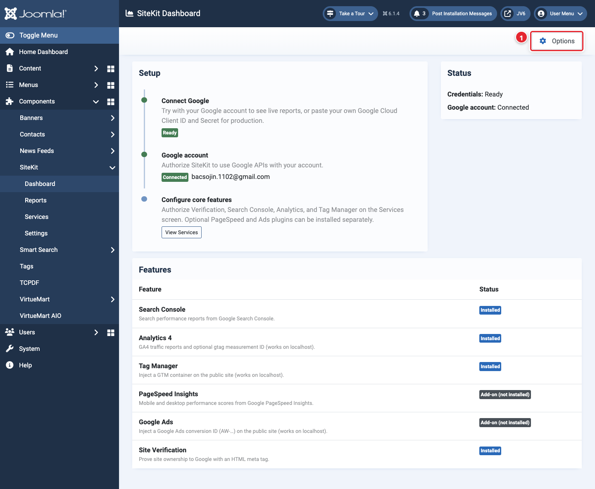

2. Choose a user group on the left, set each action to **Allowed** or **Denied** (2a), then click **Save & Close** (2b).

   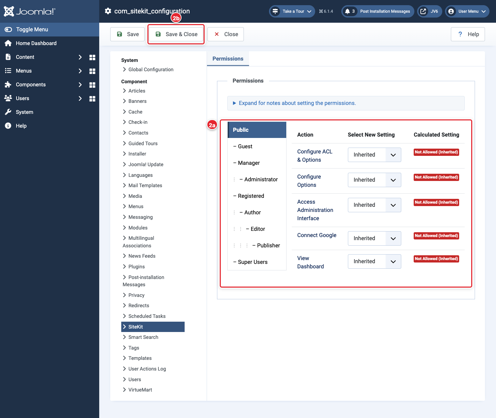

| Action | Allows the group to |
| --- | --- |
| Access Administration Interface or View Dashboard | Open the Dashboard, Reports and Services screens and load reports |
| Connect Google | Connect or disconnect Google, start or end the trial, authorize Google access, and save the cards on Services |
| Configure ACL & Options | All of the above, plus the **Settings** screen (Client ID and Secret) and this Options screen |

## Troubleshooting

Most problems come from Google not being connected yet, or from a Google account that has no access to the site's properties.

| You see | What to do |
| --- | --- |
| **Connect Google in Settings before using feature add-ons.** | Connect Google first: see the trial or your own Google Cloud client section. |
| **Client ID and Client Secret are required before connecting.** | Paste both on the Settings screen and click **Save & Close**, then **Connect with Google**. |
| **Google authorization failed** or **Invalid OAuth state** | Try **Connect with Google** again. Check that the redirect URI in Google Cloud matches the one on the Settings screen exactly. |
| **No refresh token available** | Click **Disconnect** on Settings, then **Connect with Google** again and allow access. |
| **Connect Search Console scope and select a property in Services** | On Services, click **Authorize Google scopes** in the Search Console card if shown, choose a property and save. |
| **Authorize Analytics scope and select a GA4 property in Services** | The same, in the Analytics 4 card. |
| The property list is empty | The connected Google account has no access to the site in Search Console or Analytics. Connect the account that manages the site, or ask the property owner to add you. |
| **Gathering data…** | Normal for up to 48 hours after connecting a property. |
| **Trial service request failed** or **Could not start the Google trial** | The trial service is not available. Connect your own Google Cloud client. |
| **Your SiteKit trial has ended** | Connect your own Google Cloud client to keep using reports. |
| **Google API request failed (HTTP ...)** | Google refused the request. Wait a few minutes and click **Refresh**; if it keeps happening, disconnect and connect again. |
| A card shows **Add-on (not installed)** | PageSpeed Insights and Google Ads are optional extras. Install their SiteKit plugin first. |

This is the message you see on the Services and Reports screens before Google is connected:

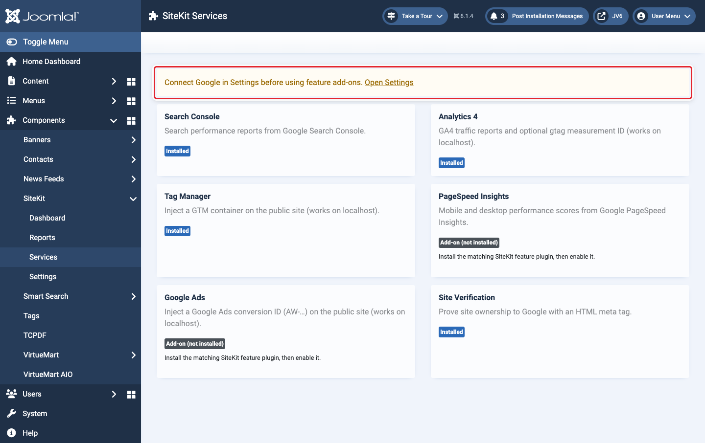
